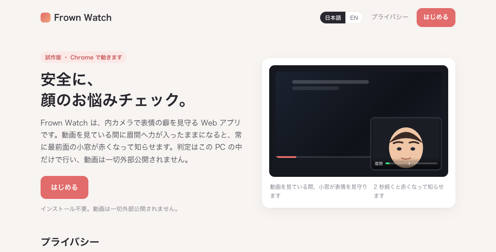
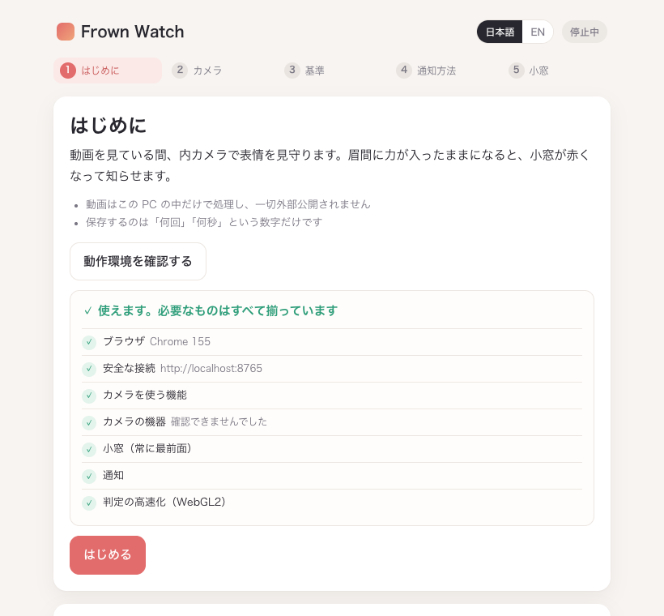

# Frown Watch

動画を見ている間、内カメラで表情の癖を見守り、眉間に力が入ったままになると小窓が赤くなって知らせる Web アプリです。
判定はすべてブラウザの中で行い、**動画は一切外部公開されません**。

**▶ 使ってみる: https://taiki-jp.github.io/frown-watch/**

日本語と英語に対応しています。 ／ Available in Japanese and English. [English summary below](#english).



## できること

- **その場で知らせる** — 眉間、額、目元、口角、口の開き。力みが 2 秒以上続くと、常に最前面の小窓の枠が赤く点滅します。音や通知を足すこともでき、鳴りすぎないよう間隔をあけます
- **癖の推移が見える** — 今日の回数、1 時間あたりの回数、14 日の推移。記録が溜まると先週との比較が一文で出ます
- **動画は一切外部公開されません** — ライブラリとモデルはページと一緒に配布され、外部のサーバーには何も送りません。確認方法も公開しています

## 使い方

1. Chrome で https://taiki-jp.github.io/frown-watch/ を開き、「はじめる」を押します
2. 初回はセットアップが 5 段階で進みます
   1. はじめに — 動作環境の確認
   2. カメラ — 内カメラを許可して映りを確認
   3. 基準 — 無表情で 3 秒待ち、その顔を「0」にする
   4. 通知方法 — 音と通知を選ぶ
   5. 小窓 — 常に最前面の小窓に切り替える
3. 小窓を出したまま、いつもどおり動画を見ます。眉間に力が入ったままになると小窓が赤くなります
4. 2 回目からはふだんの画面が開きます。「見守りを開始」→「小窓にする」で同じ状態になります



## 動作環境

- Chrome 116 以降（Edge などの Chromium 系でも動きます）。小窓表示は Safari と Firefox では使えません
- 内蔵カメラのある PC、または外付けカメラ
- インストール不要。アプリの中の「動作環境を確認する」で、足りないものを確認できます

## プライバシー

- 内カメラの動画はこの PC の中だけで処理し、一切外部公開されません
- 保存するのは、癖が出た回数と秒数、見守った時間、無表情の基準値だけです。ブラウザの localStorage にだけ残ります
- 判定に使うライブラリとモデルはページと一緒に配布しています。外部のサーバーからは何も読み込みません

### 動画が外部公開されないことの確認方法

1. 開発者ツールの Network タブを開いたまま見守りを開始する。最初の読み込み以外に通信が起きません
2. 見守りを開始したあとに Wi-Fi を切っても、そのまま動き続けます
3. ページの CSP（Content-Security-Policy）で、配布元以外への通信をブラウザ自身が禁止しています。`app.html` と `index.html` の冒頭にある meta タグで確認できます
4. ビルド工程がなく、このリポジトリのファイルがそのまま配信されています。配布物とリポジトリを突き合わせられます

## 設定

- **見守る癖** — 5 つの癖を個別にオン・オフできます
- **敏感さ** — 敏感・標準・鈍感の 3 段階。鳴りすぎると感じたら「鈍感」に
- **通知方法** — 音、通知、その間隔
- **無表情の基準** — いつでも取り直せます
- **データ** — CSV で持ち出せます。今日の分だけ消すこともできます
- **詳細設定** — しきい値、継続秒数、休止秒数を癖ごとに調整できます

## 仕組み

1. [MediaPipe Face Landmarker](https://ai.google.dev/edge/mediapipe/solutions/vision/face_landmarker) が顔の 478 点と 52 種類の表情係数（blendshape）を端末内で推定します
2. 無表情の基準からの増分がしきい値を超えた状態が、継続秒数だけ続いたら 1 回と数えます
3. 小窓は Chrome の Document Picture-in-Picture で、ほかのアプリの上にも残ります

## 開発者向け

### ローカルで動かす

```sh
git clone https://github.com/Taiki-jp/frown-watch.git
cd frown-watch
python3 -m http.server 8765 --bind 127.0.0.1
```

Chrome で http://localhost:8765/ を開きます。カメラは https か localhost でしか使えません。

### ファイル構成

| ファイル | 役割 |
|---|---|
| `index.html`, `top.js` | トップページと CSS アニメーションのデモ |
| `app.html`, `app.js` | アプリ本体。判定と表示のすべて |
| `i18n.js` | 日本語と英語の辞書と切り替え |
| `vendor/mediapipe/` | MediaPipe Tasks Vision 1.1.0（Apache-2.0） |
| `vendor/models/face_landmarker.task` | 顔 landmark と blendshape のモデル（Apache-2.0） |
| `vendor/NOTICE.md` | 同梱物の取得元と SHA-256 |
| `test/` | 判定ロジックと診断値の単体テスト |

### テスト

```sh
node test/logic.test.mjs
node test/diag.test.mjs
```

### 開発用の URL パラメータ

`app.html` に付けて使います。

| パラメータ | 動き |
|---|---|
| `?autostart` | セットアップを飛ばして見守りを開始 |
| `?ob=3` | セットアップの 3 番目を開く |
| `?open` | 折りたたみを全部開く |
| `?env` | 動作環境チェックを実行 |
| `?lang=en` | 言語を指定して開く（`index.html` でも可） |

### 判定に使える生の値

アプリの「開発者向けの診断」に、blendshape、landmark の距離比、眉間の皮膚の画素から出した値が並びます。判定方式を検討するための表です。

## ライセンス

MIT License。同梱している MediaPipe とモデルは Apache-2.0 です。詳細は `vendor/NOTICE.md` を見てください。

---

## English

**Frown Watch** is a web app that watches your facial habits through the front camera while you watch videos. When your brow stays tense, an always-on-top mini window turns red to let you know. Everything runs inside the browser; **your video is never shared**.

- **Try it:** https://taiki-jp.github.io/frown-watch/?lang=en
- **Requirements:** Chrome 116 or later and a camera. The mini window is not available in Safari or Firefox
- **Privacy:** video is processed only on your computer. Only counts, seconds, watch time and your neutral baseline are stored, in `localStorage`. The detection library and model ship with the page, and a Content-Security-Policy blocks any connection except to the page's own origin
- **How it works:** [MediaPipe Face Landmarker](https://ai.google.dev/edge/mediapipe/solutions/vision/face_landmarker) estimates 478 landmarks and 52 blendshapes on device; a habit counts when the change from your neutral baseline stays above a threshold for a few seconds; the mini window uses Chrome's Document Picture-in-Picture
- **Run locally:** `python3 -m http.server 8765 --bind 127.0.0.1`, then open http://localhost:8765/
- **License:** MIT. Bundled MediaPipe and model are Apache-2.0 (see `vendor/NOTICE.md`)
